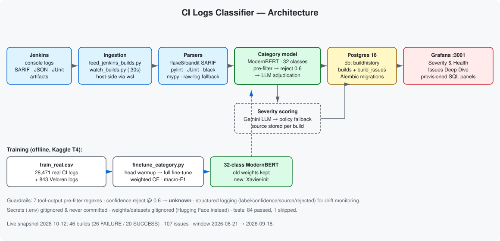

# CI Logs Classifier

End-to-end **CI failure intelligence** for Jenkins: ingest every build, classify each
failure with a fine-tuned **ModernBERT** model, score its operational **severity**
(LLM + deterministic policy fallback), persist everything in **PostgreSQL**, and
visualize it in **Grafana**.

Built with production guardrails (tool-output pre-filtering, confidence rejection,
LLM adjudication) and structured prediction logging for drift monitoring.


> **Status:** tests green — **84 passed, 1 skipped** (`python -m pytest tests/ -q`).
> Live pipeline snapshot: **46 builds (26 FAILURE / 20 SUCCESS), 107 issues**, 2026-08-21 → 2026-09-18.

---

## Table of contents

- [Overview](#overview)
- [Architecture](#architecture)
- [Pipeline stages](#pipeline-stages)
- [Model & measured results](#model--measured-results)
- [Production guardrails](#production-guardrails)
- [Tech stack](#tech-stack)
- [Project structure](#project-structure)
- [Getting started](#getting-started)
- [Configuration](#configuration)
- [Usage](#usage)
- [Database schema](#database-schema)
- [Testing & CI](#testing--ci)
- [Limitations](#limitations)
- [Security notes](#security-notes)
- [License](#license)

---

## Overview

CI pipelines produce noisy, high-volume logs, and "the build is red" is rarely enough
to act on. This project answers three questions automatically for every Jenkins build:

1. **What broke?** — a category label (e.g. `containers_docker`, `test_failure`).
2. **How bad is it?** — a severity level (`Low` / `Medium` / `High` / `Critical`).
3. **What is the evidence?** — the parsed, per-tool issue lines that drove both decisions.

The result is a searchable history (Postgres) plus live dashboards (Grafana) that show
failure rate, severity trends, category distribution, and an issue-level deep dive.

---

## Architecture



```
Jenkins (WSL2 container)
        │  build.xml · build-output.log · artifacts (SARIF / JSON / JUnit XML)
        ▼
┌───────────────────────────────────────────────────────────────┐
│ Ingestion            feed_jenkins_builds.py / watch_builds.py  │
│   1. list builds          2. fetch meta + log + artifacts      │
│   3. parse per-tool issues (flake8, pylint, mypy, black,       │
│      bandit, pytest) → severity + evidence                     │
└───────────────┬───────────────────────────────────────────────┘
                ▼
┌───────────────────────────────────────────────────────────────┐
│ Classification       ml/category_model.py                      │
│   regex pre-filter → ModernBERT (32-class) → reject if unsure  │
│   → Gemini adjudication of top-k → label | "unknown"           │
└───────────────┬───────────────────────────────────────────────┘
                ▼
┌───────────────────────────────────────────────────────────────┐
│ Severity             ml/severity_llm.py                        │
│   Gemini scoring → deterministic policy fallback               │
│   (severity_policy.json: tool codes, signals, baselines)       │
└───────────────┬───────────────────────────────────────────────┘
                ▼
        PostgreSQL (builds, build_issues)  ──▶  Grafana dashboards
```

---

## Pipeline stages

Per build: **collect → parse → classify → score → store → visualize**.

| Stage | What happens | Where |
|---|---|---|
| **Collect** | Pull `build.xml`, `build-output.log` (or console log) and archived artifacts from the Jenkins container | `feed_jenkins_builds.py::fetch_build` |
| **Parse** | Regex + structured parsers turn tool output into issue records (severity, category, line, `is_error`) | `parse_artifacts`, `parse_sarif_*`, `parse_pylint_json`, `parse_junit_xml`, `parse_black_log` |
| **Classify** | Map the failure to a root-cause category | `ml/category_model.py` |
| **Score** | Assign operational severity with reason | `ml/severity_llm.py` |
| **Store** | Upsert into `builds` + `build_issues` | `feed_jenkins_builds.py::ingest_build` |
| **Visualize** | Provisioned Grafana dashboards + Postgres datasource | `grafana/` |

**Parsers cover:** flake8 (SARIF), bandit (SARIF), pylint (JSON), pytest (JUnit XML),
plus mypy and black (log-line patterns). ANSI escape codes are stripped before matching.

**Two ingestion modes:**

- `feed_jenkins_builds.py` — bulk back-fill of every historical build.
- `watch_builds.py` — poll loop for near-real-time ingestion of new builds.

---

## Model & measured results

### Category model — 10-class base (recorded training outputs, epoch 3.0)

`eval_accuracy` **0.7709**, `eval_f1` **0.7714**, support **14,320**:

| class | precision | recall | f1 | support |
|---|---|---|---|---|
| auth_permission_error | 0.79 | 0.83 | 0.81 | 1489 |
| ci_config_git | 0.92 | 0.85 | 0.88 | 1499 |
| containers_docker | 0.82 | 0.84 | 0.83 | 1426 |
| database_error | 0.73 | 0.78 | 0.76 | 1492 |
| network_api_error | 0.72 | 0.73 | 0.72 | 1463 |
| out_of_memory | 0.81 | 0.74 | 0.77 | 1496 |
| runtime_error | 0.68 | 0.72 | 0.70 | 1493 |
| syntax_error | 0.73 | 0.69 | 0.71 | 1491 |
| test_failure | 0.73 | 0.81 | 0.77 | 1414 |
| timeout_error | 0.82 | 0.70 | 0.76 | 1057 |
| **macro avg** | **0.78** | **0.77** | **0.77** | **14320** |

### Category model — 32-class extension

Fine-tuned on 28,471 real CI logs + 843 Veloren logs
(`ml/finetune_category.py`, `ml/category_extension_training.ipynb`): the original
10-class head weights are preserved, 22 new classes are Xavier-initialized, then a
two-phase train runs (head warmup → full fine-tune).

E2E-verified against the real model (wire-in, pre-filter/reject/LLM paths, logging,
feed compatibility) and **26/26 `test_category_model.py` tests pass**. A full 5-fold
cross-validation of the 32-class head (`ml/cross_val_eval.py`) is implemented but not
yet run — see [Limitations](#limitations).

### Live pipeline snapshot (Postgres, queried 2026-10-12)

| metric | value |
|---|---|
| builds | 46 (26 FAILURE / 20 SUCCESS) |
| build_issues | 107 |
| window | 2026-08-21 → 2026-09-18 |
| top categories | clean 18, Test 11, syntax_error 9, Repository 4, CI Orchestration 3, unknown 1 |

The `unknown` row shows the rejection path working on production data, not just in tests.

### Models on Hugging Face

- Category: [`ferjaboss/ci-logs-classifier`](https://huggingface.co/ferjaboss/ci-logs-classifier)
- Root cause: `aziz123123v/cicd-log-rootcause`

---

## Production guardrails

- **Tool-output pre-filter** — 7 anchored regexes (ruff/flake8/pylint/mypy/bandit/eslint/tsc/shellcheck/trivy/gitleaks/pytest) short-circuit obvious tool lines before the model sees them (the model was never trained on these formats).
- **Confidence rejection** — `CATEGORY_REJECT_THRESHOLD` (default `0.6`); below-threshold predictions become `unknown` instead of a confident misclassification.
- **LLM adjudication** — Gemini re-ranks the top-k candidates when a key is configured; raises cleanly otherwise so callers fall back to `unknown`.
- **No silent failures** — severity always resolves (`llm` → `policy`), and the source is stored per build in `builds.severity_source`.
- **Drift logging** — every prediction logs `label`, `confidence`, `source`, `num_labels`, `rejected`.

---

## Tech stack

| Layer | Technology |
|---|---|
| Language | Python 3.12 |
| ML | PyTorch (CPU), Hugging Face Transformers, ModernBERT, safetensors, tokenizers |
| LLM | Google Gemini (severity + category adjudication) |
| Storage | PostgreSQL 16 + Alembic migrations |
| Visualization | Grafana (provisioned dashboards + datasource) |
| Orchestration | Docker, Docker Compose, Jenkins pipeline, systemd unit |
| Quality | pytest, ruff, black, mypy, bandit, flake8, pylint, pip-audit, trufflehog, GitHub Actions |

---

## Project structure

```
ci-logs-classifier/
├── feed_jenkins_builds.py     # bulk ingestion + per-tool parsers
├── watch_builds.py            # poll loop (near-real-time ingestion)
├── db.py                      # Postgres connection + schema helpers
├── logging_config.py          # structured (JSON) logging setup
├── Dockerfile                 # python:3.12-slim, CPU torch, non-root user
├── docker-compose.yml         # postgres · grafana · feed/watch profiles
├── Jenkinsfile                # pipeline that produces the analyzed logs
├── alembic.ini
├── migrations/
│   ├── env.py
│   └── versions/0001_initial.py        # builds, build_issues
├── ml/
│   ├── category_model.py              # 32-class classifier + guardrails
│   ├── finetune_category.py           # extension training
│   ├── category_extension_training.ipynb
│   ├── cross_val_eval.py              # stratified k-fold evaluation
│   ├── severity_llm.py                # Gemini severity + adjudication
│   └── severity_policy.json           # deterministic fallback policy
├── grafana/
│   ├── make_dashboards.py             # regenerate dashboard JSON
│   └── provisioning/                  # datasource + dashboard definitions
├── tests/                             # pytest suite
├── docs/architecture.svg
├── ci-build-watcher.service           # systemd unit (Linux host)
├── logrotate.conf
├── pytest.ini · ruff.toml · requirements.txt
└── .github/workflows/ci.yml
```

---

## Getting started

### Prerequisites

- Windows + WSL2 with Docker Desktop (ingestion reaches Jenkins through the `wsl` binary), **or** a Linux host with Jenkins data mounted.
- Python 3.12+
- Docker & Docker Compose

### Install & run

```bash
pip install -r requirements.txt

docker compose up -d postgres grafana     # Grafana → http://localhost:3001
alembic upgrade head                      # on a fresh database
python feed_jenkins_builds.py --since 1   # bulk ingest (runs on the host)
```

Then open Grafana at **http://localhost:3001** and log in with `GF_ADMIN_USER` /
`GF_ADMIN_PASSWORD`.

---

## Configuration

Environment is read from a gitignored **`.env`** file (`env_file:` in compose):

| Variable | Purpose |
|---|---|
| `DB_HOST` / `DB_PORT` / `DB_NAME` / `DB_USER` / `DB_PASSWORD` | Postgres connection |
| `POSTGRES_USER` / `POSTGRES_PASSWORD` / `POSTGRES_DB` | Postgres container bootstrap |
| `GEMINI_API_KEY` | Enables LLM severity + adjudication |
| `GEMINI_MODEL` | Primary Gemini model (falls back across a list on quota/429) |
| `SEVERITY_LLM_PROVIDER` | `gemini` (default) or `none` |
| `CATEGORY_MODEL_DIR` | Override the extended-model directory |
| `CATEGORY_REJECT_THRESHOLD` | Abstain threshold (default `0.6`) |
| `GF_ADMIN_USER` / `GF_ADMIN_PASSWORD` | Grafana admin credentials |

Model weights (`model.safetensors`, `category_model_finetuned/`, `*.zip`) are
gitignored — fetch the model from Hugging Face instead of committing binaries.

---

## Usage

### Ingestion

```bash
python feed_jenkins_builds.py                 # all builds
python feed_jenkins_builds.py --since 30      # only build >= 30
python feed_jenkins_builds.py --clear         # delete rows first
python feed_jenkins_builds.py --no-llm        # rule-based severity only

python watch_builds.py                 # run forever (Ctrl+C to stop)
python watch_builds.py --once          # one poll cycle and exit
python watch_builds.py --interval 60   # poll every 60s
```

Compose profiles: `--profile ingest` (one-shot feed) and `--profile watch` (continuous watcher).

### Dashboards

```bash
docker compose up -d grafana
python grafana/make_dashboards.py      # regenerate dashboard JSON if edited
```

Two dashboards ship provisioned:

- **CI Build Severity & Health** — totals, failure rate, severity trend, latest builds.
- **CI Build Issues Deep Dive** — issue severity/category breakdown + detail table.

### Key modules

| File | Purpose |
|---|---|
| `feed_jenkins_builds.py` | bulk ingestion of Jenkins builds into Postgres |
| `watch_builds.py` | poll loop (`--interval`), compose `--profile watch` |
| `ml/category_model.py` | 32-class classifier + guardrail pipeline |
| `ml/finetune_category.py` / `ml/category_extension_training.ipynb` | extension training |
| `ml/cross_val_eval.py` | stratified k-fold evaluation |
| `ml/severity_llm.py` | Gemini severity + category adjudication |
| `grafana/make_dashboards.py` | regenerate dashboard JSON |
| `migrations/` | Alembic revisions (`builds`, `build_issues`) |
| `tests/` | pytest suite (parsers, LLM, analyzer, reporter, loader, category model) |

---

## Database schema

**`builds`** — one row per Jenkins build.

| column | type | notes |
|---|---|---|
| `build_id` | int (PK) | Jenkins build number |
| `timestamp` | timestamptz | build start time |
| `error_count` / `warning_count` | int | parsed issue counts |
| `result` | varchar(20) | `SUCCESS` / `FAILURE` / … |
| `category` | varchar(50) | predicted root-cause category |
| `llm_severity` | varchar(20) | `Low`/`Medium`/`High`/`Critical` |
| `severity_source` | varchar(20) | `llm` or `policy` |
| `severity_reason` | text | one-sentence justification |
| `trend` | text | reserved |

**`build_issues`** — one row per parsed issue (FK → `builds.build_id`, `ON DELETE CASCADE`).

| column | type | notes |
|---|---|---|
| `issue_id` | int (PK) | |
| `build_id` | int (FK) | |
| `timestamp` | timestamptz | |
| `severity` | varchar(20) | per-issue severity |
| `category` | varchar(50) | tool category (flake8, pylint, …) |
| `line` | text | evidence line |
| `is_error` | bool | `true` = error, `false` = warning |

Indexes: `ix_builds_timestamp`, `ix_builds_category`, `ix_build_issues_build_id`, `ix_build_issues_severity`.

---

## Testing & CI

```bash
python -m pytest -q                                   # 84 passed, 1 skipped
ruff check .
python -m black --check feed_jenkins_builds.py watch_builds.py db.py ml/ tests/
python -m mypy --ignore-missing-imports --follow-imports=silent feed_jenkins_builds.py db.py ml/severity_llm.py ml/category_model.py logging_config.py watch_builds.py
```

GitHub Actions (`.github/workflows/ci.yml`) runs four jobs:

1. **Lint & Test** — ruff, black `--check`, mypy, pytest with coverage, informational `pip-audit`.
2. **Docker Build** — builds the image and smoke-imports every module.
3. **Alembic Migrations** — `upgrade head`, then `downgrade -1 && upgrade head`.
4. **Secrets Scan** — trufflehog (verified results only).

---

## Limitations

- Training labels are **heuristic/regex-assigned, not human-verified**; the 10 original classes have zero test coverage.
- The 32-class head has e2e + unit verification but **no full cross-validation numbers yet**.
- Gemini free tier (~20 req/day/model) means large back-fills will produce `policy` fallbacks.
- Ingestion is coupled to a Windows/WSL2 host (the `wsl` binary); no Postgres backups; dependencies unpinned (`>=` floors, `grafana:latest`).

## Security notes

- `.env` is gitignored **and** was never committed; full history was scanned (2026-10-12) — no API keys, tokens, private keys, or hardcoded passwords found (only variable-name references and weak compose *defaults*, which fail safe only with `.env` present).
- Heavy artifacts and personal files are gitignored; verify with `git ls-files`.

## License

No license file yet. Add one (e.g. MIT) before reuse by others.
